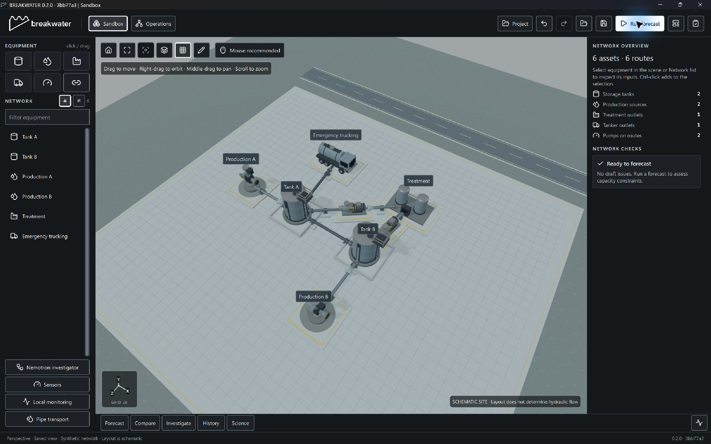
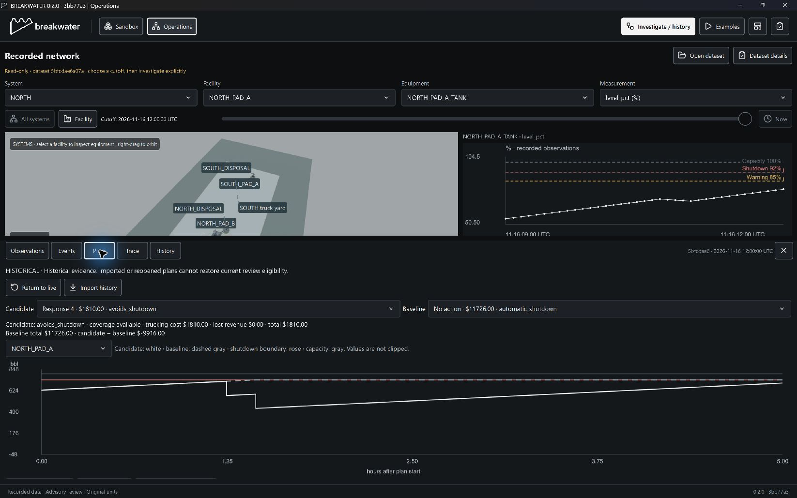

# BREAKWATER

Breakwater is a Windows desktop workbench for investigating synthetic fluid
networks and recorded operating data. It combines an editable industrial 3D
workspace, native numerical forecasts, bounded response search, independent
validation, and persistent evidence. A human reviews an exact validated plan
before any simulated controls change.

The v0.2.0 portfolio candidate leads with **Sandbox**, the editable network
workbench. **Operations** presents recorded observations and advisory analysis;
EOG remains a supported dataset adapter. Neither workspace controls a plant.

Unreleased v0.3 development adds seeded local acquisition, immutable observed
captures, bounded symptom detection, native advisory forecasts, v2 evidence
history and manual Science on stored candidates. See the
[implementation ledger](docs/NEXT_RELEASE.md), [local monitoring](docs/LOCAL_MONITORING.md)
and [workspace clarity checks](docs/WORKSPACE_CLARITY.md).

Clean engineering candidate `3bb77a3` passes 88/88 normal CTest suites, 88/88 ASan
suites and all 78 helper tests. The tested normal executable matches the sealed
Windows package; ten bundled checks pass both in place and after extracting the
actual ZIP to a spaces/Unicode path. All six
[Windows CI jobs](https://github.com/Towstar/Breakwater/actions/runs/44823006438)
pass for its matching source tree. These are local and CI results, not
clean-Windows acceptance.

The second hosted round passes all seven declared cases: protocol smoke, three
canonical Operations investigations, a renamed/topology case, an observed-pump
advisory and a missing-coverage refusal. The first round's failed exact-validation
case remains retained. Repeated tool calls and model prose errors remain explicit
limitations; this is not a general reliability or numerical-accuracy claim. See
[candidate results](docs/CANDIDATE_RESULTS_3BB77A3.md) and
[release readiness](docs/CANDIDATE_READINESS.md). A private Windows/source handoff
kit is staged. Required owner/licensing review and actual clean-Windows acceptance
remain unverified; no v0.3 public binary has been released.





The [source-labeled gallery](docs/images/portfolio/README.md) records actual
running-app views at `3bb77a3`, including scene focus, Connections, observed-state
comparison, advisory review and retained hosted history. Historical views make no
new model request and restore no operating authority. Older galleries retain their
original source labels; screenshots supplement the separate executable evidence.

The [prior v0.2 qualification record](docs/evidence/portfolio/release-readiness/README.md)
binds candidate `ad45d45` to six passing Windows CI jobs and nine passing portable
checks. Its fresh hosted round passed two of three Operations investigations and
the renamed-network investigation; the third Operations final was rejected for
invalid JSON. That source's all-four hosted gate was incomplete. Owner review, licensing
and an actual clean Windows VM check remain pending before a public binary release.

| Area | Available behavior | Boundary |
|---|---|---|
| Sandbox | Equipment/pipe editing, group transforms, undo/redo, native trajectories | Fixed flow/volume model; layout is schematic |
| Local investigation | Actual bounded native search and independent validation | No API key; best found on the declared finite grid |
| Nemotron | Real hosted tool calling, evidence-bound recommendations, retained request metadata | Optional; model errors and ungrounded finals are rejected |
| Operations | Read-only import, original-unit plots, detection, response search and exact validation | Synthetic/recorded advisory analysis, no dispatch |
| History | SQLite persistence, filtered browsing, versioned import/export, compatible comparison | Imported/replayed evidence never restores approval |
| Local monitoring (v0.3 development) | Seeded synthetic input, timed replay, frozen coverage, bounded detection and native advisory investigation | Measurements remain separate from commands; nominal forecasts, no actuation |
| Optional Science | Torch storage comparison/sensitivity and bounded PhysicsNeMo tracer fitting | Separate pinned CPU installation, explicit parameter application |
| Proofs | Standalone Lean/Mathlib checks of specified algorithms and assumptions | Not a proof of the desktop, a field model or every recommendation |

See [the offline walkthrough](docs/PORTFOLIO_WALKTHROUGH.md),
[architecture and ownership](docs/ARCHITECTURE.md), and
[the release ledger](docs/PORTFOLIO_RELEASE.md). Actual results and remaining gates
are recorded in [STATUS](docs/STATUS.md); historical hackathon reports retain
their original source/runtime scope.

## Build and run on Windows

Use Visual Studio 2022 with Desktop C++, CMake/Ninja, PowerShell 7, a 64-bit
bootstrap Python 3.12 interpreter, and the pinned
Qt 6.12.0 MSVC 2022 x64 SDK. Qt Quick, Quick Controls, Quick 3D, SVG, SQL, Network
and Qt Test are used. The repository's installer records the exact Qt archives.

```powershell
# Project-local setup. Does not change registry/PATH permanently.
python -m venv .tools/ci-bootstrap
& ./.tools/ci-bootstrap/Scripts/python.exe -m pip install --require-hashes -r scripts/ci/requirements-win-py312.txt
& ./.tools/ci-bootstrap/Scripts/python.exe scripts/install-qt.py
./scripts/Setup-ScientificWorker.ps1

# In a VS developer PowerShell, or after the compiler bootstrap:
./scripts/ci/Initialize-Compiler.ps1
cmake --preset portfolio -DCMAKE_PREFIX_PATH="C:/PATH/TO/Qt/6.12.0/msvc2022_64" -DPython3_EXECUTABLE="C:/PATH/TO/Breakwater/.tools/science-cpu/Scripts/python.exe" -DCMAKE_MSVC_DEBUG_INFORMATION_FORMAT=Embedded
cmake --build --preset portfolio --parallel 3
ctest --preset portfolio
./scripts/Start-Portfolio.ps1 -QtPrefix "C:/PATH/TO/Qt/6.12.0/msvc2022_64"
```

Use absolute paths for external SDKs/interpreters. `BREAKWATER_PYTHON` explicitly
overrides the worker interpreter. An incompatible explicit override fails visibly;
it is not silently replaced. The isolated portable runtime is used automatically
only when no override is supplied. Missing optional science never blocks native
forecasts or recorded 3D viewing.

For Visual Studio, use Open Folder and the existing checked Windows build script
with the pinned Qt prefix. [Windows check instructions](docs/WINDOWS_CHECKS.md)
cover normal/AddressSanitizer configurations and retained job artifacts. No hosted
Nemotron request runs in credential-free CI. The manual Optional CPU Science
workflow installs and qualifies the real pinned PhysicsNeMo environment separately.

## Try the offline examples

Sandbox starts with a healthy synthetic network. Project contains healthy,
failed-pump, bad-reroute and mixed-response examples. Run a forecast, select a
tank, and inspect the full trajectory including negative/overflow values. Choose
Investigate and Local search for real numerical investigation without a model.

Operations → Examples loads the self-authored datasets under
[examples/portfolio](examples/portfolio/README.md). Importing a dataset never
starts an investigation. Select a cutoff, run Search plans and Validate exact
plan explicitly. History can export and reopen the complete captured evidence.
A bundled recorded Nemotron session is clearly historical, and makes no new
hosted request. The renamed/topology-changed fixture requires fresh analysis.

The source verification helper exercises import → actual search → independent
validation → SQLite completion → archive export → historical reopening:

```powershell
out/portfolio-desktop/desktop/breakwater_offline_check.exe "C:/ABSOLUTE/Breakwater/examples/portfolio/operations" "C:/ABSOLUTE/EXISTING/OUTPUT"
```

## Interaction

- Click or drag equipment into the scene. Ctrl-click toggles selection; Shift adds
  assets or extends a navigator range; a background marquee selects a group.
- Group moves snap a common delta to a 20-unit grid and commit as one undo action.
  Ctrl+D duplicates selected assets and internal routes with new identities.
- Edit contains align/distribute/delete actions. Incident routes are removed with
  deleted equipment; attached sensor guards prevent silently deleting evidence.
- Home, Fit, Focus and Top change the view. Right-drag orbits, middle-drag pans,
  and the wheel zooms. Camera/pad/marker placement supplies no hydraulic geometry.
- F1 or Mouse recommended opens keyboard help. Ctrl+Home restores the view,
  Ctrl+0 fits the network and F focuses the selection. Dense views prioritize
  selected/hovered labels; the Network list still contains every asset.
- Forecast, Compare, Investigate, History and Science share a resizable results
  dock. Drag its top edge upward to give charts and evidence more room. Repeated
  utility-button clicks close the corresponding tool.
- View contains panel visibility, low/medium/high quality, label and density
  preferences. These are local/versioned and separate from project files.

## Optional Science and hosted Nemotron

```powershell
./scripts/Setup-OptionalScience.ps1
./scripts/Start-Portfolio.ps1 -Science -QtPrefix "C:/PATH/TO/Qt/6.12.0/msvc2022_64"
```

The pinned optional CPU environment uses Python 3.12.13, Torch 2.15.0+cpu and
PhysicsNeMo 2.2.2. It fits a bounded scalar tracer-decay parameter to entered
synthetic observations. The fitted value stays staged until explicit application;
applying it retires stale numerical approval. This does not establish field
chemistry, pressure hydraulics or calibrated predictive accuracy.

Use API key settings in the app or a local `NVIDIA_API_KEY`. Never commit keys or
paste them into issues/screenshots. The current hosted model is
`nvidia/nemotron-3.5-lightning-30b-a3b`. It selects tools and interprets evidence;
the numerical engine computes outcomes and an independent validator checks exact
plans. No comparative model benchmark establishes superiority over other LLMs.
See [agent integration](docs/AGENT_INTEGRATION.md) and
[the scientific worker contract](science/WORKER.md).

## Local portable candidate

```powershell
./scripts/Package-Portfolio.ps1 -Destination "C:/ABSOLUTE/NEW/CANDIDATE"
./scripts/Verify-PortfolioBundle.ps1 -Bundle "C:/ABSOLUTE/NEW/CANDIDATE/Breakwater" -EvidenceDirectory "C:/ABSOLUTE/NEW/VERIFICATION"
```

Packaging requires committed source by default and refuses to overwrite a bundle.
It stages Qt, both native providers, an isolated minimal Python runtime, local
schemas/examples, an exact source snapshot and file hashes. Torch/PhysicsNeMo
stay outside the basic bundle. Verification clears development PATH/worker
variables and runs real local tools. It is a sanitized local process check;
a clean Windows account or VM remains a distinct release gate.

Public binary distribution is pending both owners' GPLv3 agreement, completed
notices/source delivery and clean Windows verification. See
[LICENSING](docs/LICENSING.md). No GitHub release is published by these scripts.

## Ownership and further work

Lucas owns desktop/UI, 3D interaction, asynchronous adapters, shared contracts,
Nemotron integration, persistence, packaging and integration verification. Ethan
owns the numerical engine, scientific methods, sensor-generation mathematics,
response evaluator/validator/search and Lean proofs. Shared numerical changes
require Ethan's review. Codex assisted implementation, tests and troubleshooting;
runtime Nemotron is the separate optional investigation agent.

Observed-state forecasting and advisory review are implemented in the v0.3
development stack, with the declared `3bb77a3` checks recorded above. Owner review,
licensing/notices review and actual clean-Windows acceptance remain open.
Commitment-aware fleet dispatch, broader numerical accuracy studies and
remaining research methods are future work. Existing project-v1/v2
formats and evidence contracts remain compatible. See [G1](contracts/telemetry/README.md),
[G2](docs/TELEMETRY_DESKTOP.md), [pipe transport](docs/PIPE_TRANSPORT.md),
[science](science/README.md), and [proofs](proofs/README.md).
