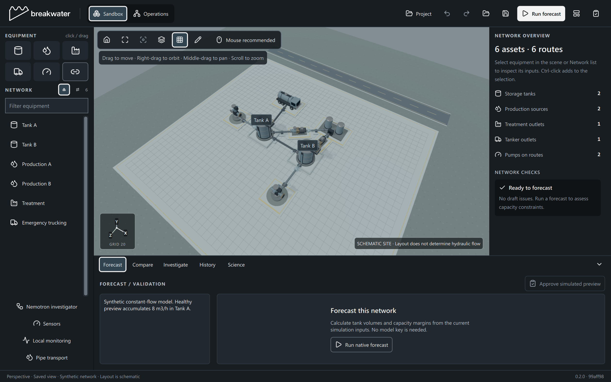
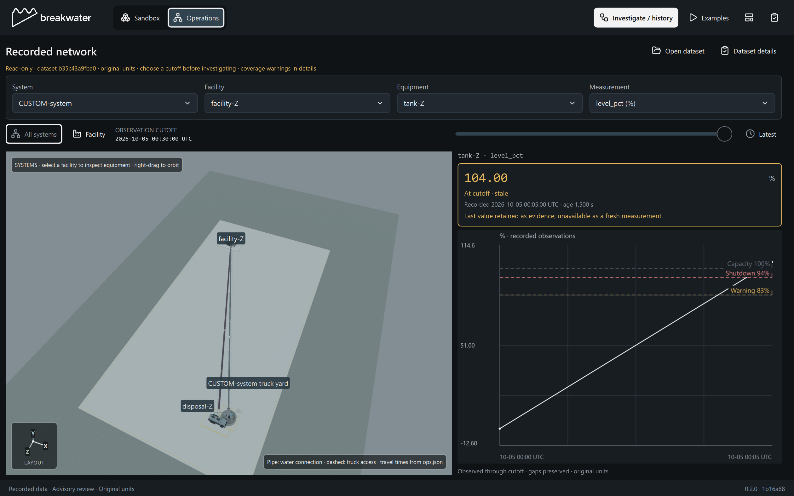

# BREAKWATER

Breakwater is a Windows desktop application for exploring synthetic fluid
networks, inspecting recorded observations and testing responses to operating
incidents. Native numerical tools compute forecasts and check exact plans;
optional NVIDIA Nemotron chooses investigation tools and follows their evidence.
Results, validation and history remain inspectable before human review.

**Sandbox** is an editable industrial 3D workbench. **Operations** is a read-only
recorded-data workspace with original-unit charts and advisory response analysis;
EOG is a supported dataset adapter. Both work locally without an API key. Neither
workspace controls a plant, and the schematic 3D layout does not define hydraulics.





These are actual synthetic-fixture captures, labeled with their runtime source.
The [gallery](docs/images/portfolio/README.md) also shows compact layouts, route
inspection, observed-state review and retained hosted traces. The current source
includes the [modern instrument UI](docs/MODERN_WORKSPACE.md) and
[Operations observation workspace](docs/OPERATIONS_WORKSPACE.md). The separate
portable review kit remains at `3bb77a3`; newer source screenshots do not qualify
that older package.

## Measured results and scope

| Evidence | Observed result | Scope |
|---|---|---|
| [Modern Operations, `1b16a88`](docs/OPERATIONS_WORKSPACE.md) | 13/13 affected CTests passed in both normal and ASan builds; actual 1440x900, 1100x700 and 960x540 clients at DPR 1.75 | Focused UI/integration checks, including real selection, cutoff and scrollbar interaction; not a full release qualification |
| [Hosted investigation, `3d91452`](docs/NEMOTRON_COMPLETION_RESULTS.md) | All seven declared fresh cases passed; canonical tool calls fell from 12 to 7 in each of three rehearsals compared with retained `3bb77a3` runs | Small descriptive rounds, not a controlled benchmark or a general model-reliability claim |
| [Retained Operations capture, `3bb77a3`](docs/images/portfolio/README.md#sealed-package-candidate-3bb77a3) | $11,726 modeled no-action cost and $1,810 selected response | Self-authored NORTH/SOUTH fixture at November 16 noon UTC; bounded search and separate exact validation, not field savings or global optimality |

The [sealed `3bb77a3` candidate](docs/CANDIDATE_RESULTS_3BB77A3.md) separately
records 88/88 normal and ASan CTests, 78 helper tests and ten portable checks in
place and after ZIP relocation. Those results retain their original source and
do not substitute for testing newer changes. Failed earlier attempts remain in
the evidence; model prose remains unverified even when its numerical references
are valid.

The source includes unreleased v0.3 work: seeded local acquisition, immutable
observed captures, bounded symptom detection, advisory forecasts, v2 history and
Science on stored candidates. See the [implementation ledger](docs/NEXT_RELEASE.md)
and [local monitoring](docs/LOCAL_MONITORING.md). Owner/licensing review and actual
clean-Windows acceptance remain release gates. No v0.3 public binary is released.

| Area | Available behavior | Boundary |
|---|---|---|
| Sandbox | Equipment/pipe editing, group transforms, undo/redo, native trajectories | Fixed flow/volume model; layout is schematic |
| Local investigation | Actual bounded native search and independent validation | No API key; best found on the declared finite grid |
| Nemotron | Real hosted tool calling, evidence-bound recommendations, retained request metadata | Optional; model errors and ungrounded finals are rejected |
| Operations | Read-only import, original-unit plots, detection, response search and exact validation | Synthetic/recorded advisory analysis, no dispatch |
| History | SQLite persistence, filtered browsing, versioned import/export, compatible comparison | Imported/replayed evidence never restores approval |
| Local monitoring (v0.3 development) | Seeded synthetic input, timed replay, frozen coverage, bounded detection and native advisory investigation | Measurements remain separate from commands; nominal forecasts, no actuation |
| Optional Science | Torch storage comparison/sensitivity and bounded PhysicsNeMo tracer fitting | Separate pinned CPU installation, explicit parameter application |
| Proofs | Standalone Lean/Mathlib checks of specified algorithms and assumptions | Not a proof of the desktop, a field model or every recommendation |

See [the offline walkthrough](docs/PORTFOLIO_WALKTHROUGH.md),
[architecture and ownership](docs/ARCHITECTURE.md), and
[the release ledger](docs/PORTFOLIO_RELEASE.md). Actual results and remaining gates
are recorded in [STATUS](docs/STATUS.md); historical hackathon reports retain
their original source/runtime scope.

The Qt desktop calls a Qt-free C++ engine and asynchronous versioned Python
workers. Nemotron uses the same bounded numerical tools, with exact retained
run/plan/validation references. Dedicated SQLite threads store completed evidence.
Measurements stay separate from commanded controls; stale or missing coverage is
explicit. Layout moves preserve numerical identity, while numerical/topology edits
retire approval. Historical imports and replay never restore actionable approval.

## Build and run on Windows

Use Visual Studio 2022 with Desktop C++, CMake/Ninja, PowerShell 7, a 64-bit
bootstrap Python 3.12 interpreter, and the pinned
Qt 6.12.0 MSVC 2022 x64 SDK. Qt Quick, Quick Controls, Quick 3D, SVG, SQL, Network
and Qt Test are used. The repository's installer records the exact Qt archives.

```powershell
# Project-local setup. Does not change registry/PATH permanently.
python -m venv .tools/ci-bootstrap
& ./.tools/ci-bootstrap/Scripts/python.exe -m pip install --require-hashes -r scripts/ci/requirements-win-py312.txt
& ./.tools/ci-bootstrap/Scripts/python.exe scripts/install-qt.py
./scripts/Setup-ScientificWorker.ps1

# In a VS developer PowerShell, or after the compiler bootstrap:
. ./scripts/ci/Initialize-Compiler.ps1
cmake --preset portfolio -DCMAKE_PREFIX_PATH="C:/PATH/TO/Qt/6.12.0/msvc2022_64" -DPython3_EXECUTABLE="C:/PATH/TO/Breakwater/.tools/science-cpu/Scripts/python.exe" -DCMAKE_MSVC_DEBUG_INFORMATION_FORMAT=Embedded
cmake --build --preset portfolio --parallel 3
ctest --preset portfolio
./scripts/Start-Portfolio.ps1 -QtPrefix "C:/PATH/TO/Qt/6.12.0/msvc2022_64"
```

Use absolute paths for external SDKs/interpreters. `BREAKWATER_PYTHON` explicitly
overrides the worker interpreter. An incompatible explicit override fails visibly;
it is not silently replaced. The isolated portable runtime is used automatically
only when no override is supplied. Missing optional science never blocks native
forecasts or recorded 3D viewing.

For Visual Studio, use Open Folder and the existing checked Windows build script
with the pinned Qt prefix. [Windows check instructions](docs/WINDOWS_CHECKS.md)
cover normal/AddressSanitizer configurations and retained job artifacts. No hosted
Nemotron request runs in credential-free CI. The manual Optional CPU Science
workflow installs and qualifies the real pinned PhysicsNeMo environment separately.

## Try the offline examples

After building, launch with `scripts/Start-Portfolio.ps1` as above. Native forecasts,
local search and the bundled recorded examples do not need NVIDIA credentials.
Torch/PhysicsNeMo is used only by the separate scientific methods.

Sandbox starts with a healthy synthetic network. Project contains healthy,
failed-pump, bad-reroute and mixed-response examples. Run a forecast, select a
tank, and inspect the full trajectory including negative/overflow values. Choose
Investigate and Local search for real numerical investigation without a model.

Operations → Examples loads the self-authored datasets under
[examples/portfolio](examples/portfolio/README.md). Importing a dataset never
starts an investigation. Select a cutoff, run Search plans and Validate exact
plan explicitly. History can export and reopen the complete captured evidence.
A bundled recorded Nemotron session is clearly historical, and makes no new
hosted request. The renamed/topology-changed fixture requires fresh analysis.

For another compatible dataset, choose **Operations → Open dataset** and select
the folder containing `network.json`, `ops.json` and `telemetry.csv`. See the
[import contract](contracts/eog/README.md) for identities, units and validation.
The scene derives its equipment and connections from the imported network;
positions are a schematic presentation. **Latest** selects the dataset's latest
retained timestamp, not the current wall clock. Public examples are self-authored
synthetic data, not EOG field measurements or challenge answer keys.

The source verification helper exercises import → actual search → independent
validation → SQLite completion → archive export → historical reopening:

```powershell
out/portfolio-desktop/desktop/breakwater_offline_check.exe "C:/ABSOLUTE/Breakwater/examples/portfolio/operations" "C:/ABSOLUTE/EXISTING/OUTPUT"
```

## Interaction

- Click or drag equipment into the scene. Ctrl-click toggles selection; Shift adds
  assets or extends a navigator range; a background marquee selects a group.
- Group moves snap a common delta to a 20-unit grid and commit as one undo action.
  Ctrl+D duplicates selected assets and internal routes with new identities.
- Edit contains align/distribute/delete actions. Incident routes are removed with
  deleted equipment; attached sensor guards prevent silently deleting evidence.
- Home, Fit, Focus and Top change the view. Right-drag orbits, middle-drag pans,
  and the wheel zooms. Camera/pad/marker placement supplies no hydraulic geometry.
- F1 or Mouse recommended opens keyboard help. Ctrl+Home restores the view,
  Ctrl+0 fits the network and F focuses the selection. Dense views prioritize
  selected/hovered labels; the Network list still contains every asset.
- Forecast, Compare, Investigate, History and Science share a resizable results
  dock. Drag its top edge upward to give charts and evidence more room. Repeated
  utility-button clicks close the corresponding tool.
- View contains panel visibility, low/medium/high quality, label and density
  preferences. These are local/versioned and separate from project files.

## Optional Science and hosted Nemotron

```powershell
./scripts/Setup-OptionalScience.ps1
./scripts/Start-Portfolio.ps1 -Science -QtPrefix "C:/PATH/TO/Qt/6.12.0/msvc2022_64"
```

The pinned optional CPU environment uses Python 3.12.13, Torch 2.15.0+cpu and
PhysicsNeMo 2.2.2. It fits a bounded scalar tracer-decay parameter to entered
synthetic observations. The fitted value stays staged until explicit application;
applying it retires stale numerical approval. This does not establish field
chemistry, pressure hydraulics or calibrated predictive accuracy.

Use API key settings in the app or a local `NVIDIA_API_KEY`. Never commit keys or
paste them into issues/screenshots. The current hosted model is
`nvidia/nemotron-3.5-lightning-30b-a3b`. It selects tools and interprets evidence;
the numerical engine computes outcomes and an independent validator checks exact
plans. No comparative model benchmark establishes superiority over other LLMs.
See [agent integration](docs/AGENT_INTEGRATION.md) and
[the scientific worker contract](science/WORKER.md).

## Local portable candidate

```powershell
./scripts/Package-Portfolio.ps1 -Destination "C:/ABSOLUTE/NEW/CANDIDATE"
./scripts/Verify-PortfolioBundle.ps1 -Bundle "C:/ABSOLUTE/NEW/CANDIDATE/Breakwater" -EvidenceDirectory "C:/ABSOLUTE/NEW/VERIFICATION"
```

Packaging requires committed source by default and refuses to overwrite a bundle.
It stages Qt, both native providers, an isolated minimal Python runtime, local
schemas/examples, an exact source snapshot and file hashes. Torch/PhysicsNeMo
stay outside the basic bundle. Verification clears development PATH/worker
variables and runs real local tools. It is a sanitized local process check;
a clean Windows account or VM remains a distinct release gate.

Public binary distribution is pending both owners' GPLv3 agreement, completed
notices/source delivery and clean Windows verification. See
[LICENSING](docs/LICENSING.md). No GitHub release is published by these scripts.

## Ownership and further work

Lucas owns desktop/UI, 3D interaction, asynchronous adapters, shared contracts,
Nemotron integration, persistence, packaging and integration verification. Ethan
owns the numerical engine, scientific methods, sensor-generation mathematics,
response evaluator/validator/search and Lean proofs. Shared numerical changes
require Ethan's review. Codex assisted implementation, tests and troubleshooting;
runtime Nemotron is the separate optional investigation agent.

For portfolio presentation, use the [offline walkthrough](docs/PORTFOLIO_WALKTHROUGH.md)
and [short read-aloud narration](docs/PORTFOLIO_DEMO_SCRIPT.md). Show the actual
capture's units, search scope and validation rather than borrowing another
fixture's cost result.

Observed-state forecasting and advisory review are implemented in the v0.3
development stack, with the declared `3bb77a3` checks recorded above. Owner review,
licensing/notices review and actual clean-Windows acceptance remain open.
Commitment-aware fleet dispatch, broader numerical accuracy studies and
remaining research methods are future work. Existing project-v1/v2
formats and evidence contracts remain compatible. See [G1](contracts/telemetry/README.md),
[G2](docs/TELEMETRY_DESKTOP.md), [pipe transport](docs/PIPE_TRANSPORT.md),
[science](science/README.md), and [proofs](proofs/README.md).
