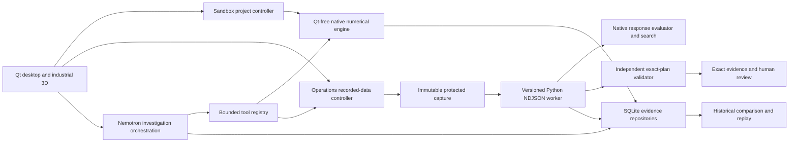

# Portfolio architecture and responsibility

Breakwater separates an editable synthetic Sandbox from recorded-data Operations.
Both use a Qt Quick/QML shell and Qt Quick 3D presentation. Equipment geometry,
gravel, pads, roads, labels and marker layout are visual only.

## Authority and identities

The native engine uses fixed rates, tank volumes, bounded controls and an explicit
simulation horizon. Network hashes exclude layout. Group layout edits are atomic
undo transactions and preserve numerical identity. Topology/numerical changes
retire old approval eligibility. Neither geometry nor model prose supplies an
independent numerical result.

Operations imports network, captured operating policy and timestamped samples.
Dataset/capture/cutoff/plan identities bind every numerical exchange. Late/future
samples, missing coverage and unsupported mappings are not silently interpreted
as zero or healthy. Search scope is explicit, finite and retained. Independent
validation recomputes one exact plan; validating a baseline cannot authorize a
different searched response.

Nemotron uses the hosted NVIDIA tool-calling API. The production orchestrators
preserve actual model-selected tool order and pair execution results with model
call IDs. Numerical tools retain results before final references are accepted.
Invalid final JSON has a bounded correction path; ungrounded references are
rejected. Sanitized request metadata contains model identity, HTTP status,
duration and retry count. Credentials and raw reasoning are excluded.

Local native search is a separate, labeled deterministic workflow through the
same actual tools. It makes no model request and claims only the chosen finite
grid. A recorded Nemotron archive is historical evidence, not a simulated live
model or a fresh investigation.

Both history repositories create/use/close SQLite connections on dedicated
threads. Completed evidence is persisted transactionally and recovered after
restart. Imports and replays never regain authority. Repository schema/contract
versions are not numerical implementation identities.

## Runtime and packaging

The basic Windows candidate stages Qt, both native provider DLLs, local EOG
schemas, self-authored examples and isolated CPython with hash-locked schema
dependencies. It has no Torch or PhysicsNeMo requirement. An explicit interpreter
override is honored and validated by the worker flow; development fallbacks are
restricted to the exact configured development binary directory.

Optional CPU Science uses a separate pinned environment. Existing storage
comparison/sensitivity and experimental scalar tracer fitting remain advisory.
Applying a fit is explicit and retires stale approval. Lean checks establish
properties of specified algorithms under recorded assumptions, not blanket
correctness of an arbitrary imported network or the UI.

## Ownership and portfolio wording

| Contributor | Main responsibility | Shared checkpoint |
|---|---|---|
| Lucas | Desktop shell, 3D/editor interactions, asynchronous adapters, Nemotron tool integration, contracts, history, packaging and integration tests | Numerical/provider changes reviewed by Ethan |
| Ethan | Native simulation/search/validation, scientific methods, sensor mathematics, numerical qualification and Lean proofs | Shared contracts and desktop integration reviewed with Lucas |

Resume wording should describe actual scope, for example:

- Lucas: Built a C++/Qt desktop workbench with a modular 3D editor, persistent
  evidence, asynchronous numerical-worker integration and guarded agentic tool
  calling; added atomic group editing and offline investigation/replay.
- Ethan: Built and qualified the numerical simulation, bounded response search,
  independent validation, scientific methods and formal algorithm checks that
  ground the desktop's recommendations.

Attach measured test counts and concrete capture-bound results from the release
report when useful. Do not claim production plant deployment, global optimization,
field-calibrated accuracy, universal LLM superiority or a completed generic sensor
pipeline. See STATUS and PORTFOLIO_RELEASE for the remaining work.
