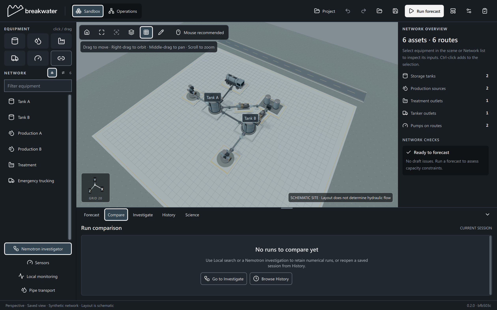
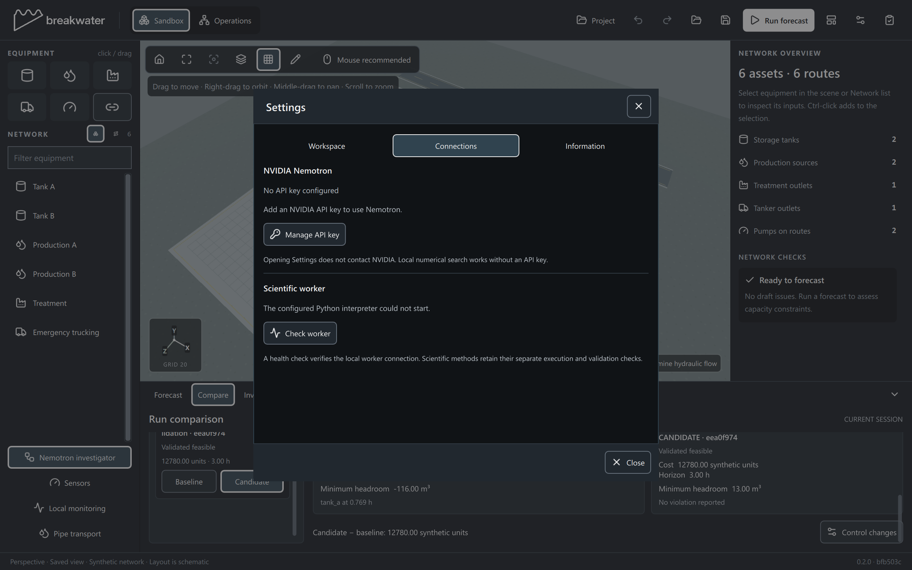

# Compare and practical Settings

November 22, 2026. Stacked on PR #98 (`8e3cce5`); application source
`bfb503cf9b781abee120aea9a96eb55ba2725e9e`.

Compare now has an actionable empty state, responsive baseline/candidate
selectors, a tank trajectory and compact evidence summaries. The view names
synthetic cost units, elapsed hours, cubic metres, validation status, minimum
headroom and the first reported violation. Its results-panel divider has a
visible resize handle.

A distinct pair with matching snapshot, physical identity and horizon can be
overlaid and compared numerically. A single run, the same run selected twice or
an incompatible pair does not receive a cost delta. Incompatible pairs show the
candidate trajectory alone. Historical and source-retired records retain their
labels; historical evidence cannot restore approval. Predictions still include
finite negative and overflowing values. Selection and charting never apply
controls.

The wide view uses a virtualized run list. Narrow views use labeled selectors,
stacked when needed. Hidden comparison views release their presentation models
and chart binding, avoiding work while a local investigation publishes results.
Existing history/controller data and numerical implementations are reused.

Settings opens from the header, View menu or **Ctrl+,** in either workspace:

- **Workspace:** existing rendering quality, compact controls and panel/label
  preferences, plus the layout grid. Preferences save locally. Restore
  preferences preserves projects, history and saved credentials.
- **Connections:** active credential-source status, the shared masked key
  dialog, worker readiness and an explicit nonblocking worker health check.
  Opening Settings makes no model request. Key changes remain blocked during
  any of the three investigation workflows.
- **Information:** the application build, controls/shortcuts and About.

The new dialogs reuse the existing heading/footer, X, Escape and focus-return
behavior. `gridVisible` is an additive Boolean in the existing version-1
preference file, defaulting to true for older files. Project, archive and
credential formats are unchanged. The renderer choice and model policy are
unchanged.

## Executed verification

The final normal and ASan matrices pass with no skips. Earlier executed results
below are retained with their actual source:

| Source | Checks | Result |
| --- | --- | --- |
| `c059cea` | Normal focused preferences/history/provider and four Compare/Settings sizes | 7/7 |
| `c059cea` | ASan focused matrix | 6/7; minimum-size frame wait failed |
| `c059cea` | Unchanged isolated ASan minimum retry | 1/1 |
| `207dd00` | Actual local-search UI probe, including retained-run browsing | 1/1 |
| `207dd00` | Remaining focused and Sandbox/observed/Operations rendering matrix | 17/17 |
| `bfb503c` | Final normal affected-area matrix, zero skips | 18/18 |
| `bfb503c` | Final ASan affected-area matrix, zero skips | 18/18 |

The final normal matrix took 135.51 seconds; ASan took 355.63 seconds. All four
new Compare/Settings checks in each build completed with zero model-request
attempts. The final local logs/JUnit reports are `out/compare-settings/final-normal-02.*`
and `out/compare-settings/final-asan-01.*`. They supersede earlier attempts only
for the executed final-source checks; those attempts remain retained.

Final executable SHA-256 identities:

- Normal: `45defcb9e9e4bd47e2a1b78cc2d226d5acc144be0583fca1300c28d9e49fc18d`
- ASan: `e0da97871a0bb7d65c1f5464ee2c761a57f1bd76e5e2b9712f69dc527ad22244`

Local tools: Qt 6.12.0, Visual Studio 17.14.36623.8 and MSVC 14.44.35219.0,
RelWithDebInfo. Render checks use D3D11/WARP; screenshots use actual Windows
scaling at DPR 1.75. Layouts are 1440x900, 1100x700, 1008x672 and 960x540.
New Compare/Settings probes use isolated preferences, credentials and databases,
rejecting model transports and a request-attempt counter. Deliberately missing
Python exercises the unavailable-worker state. Native fixtures provide actual
forecasts; deliberately incompatible display records are UI test fixtures.





These captures are from the actual final-source normal application. The
Connections image deliberately shows isolated empty credentials and the missing
worker fixture; it does not describe the user's configured installation.

The first preferences-build attempt found `BUILD_TESTING=OFF`; the existing
normal directory was reconfigured. An initial popup lookup failed because Qt
Popups are not QQuickItems; the driver now checks the popup owner's state.
The original ASan frame timeout remains recorded. The first broad UI attempt
timed out in two layouts after local search and was interrupted during the third.
Deferring hidden comparison presentation work resolved the subsequent real-search
checks. Visual inspection then found overridden ScrollView delegates losing the
native bar geometry; the final correction changes the policy on the existing
delegate and tests its placement. No test deadline or acceptance check was
relaxed. Original failed/interrupted logs remain in `out/compare-settings/`.

### Reproduce locally

Use a configured normal or ASan build with testing enabled and the existing
pinned Qt/CPU-Python toolchain. Set `BREAKWATER_PYTHON` to that interpreter and
create an absolute evidence directory before setting `BREAKWATER_UI_EVIDENCE_DIR`.
Run the following after initializing the compiler environment:

```powershell
ctest --test-dir out/reader-normal `
  -R '^desktop\.(compare_settings_(normal|compact|short|minimum)|workspace_settings|history_controller|nemotron_client|ui_overhaul_(normal|compact|short|minimum)|observed_advisory_(normal|compact|short|minimum)|eog_workspace_(normal|compact|minimum))$' `
  --output-on-failure --output-junit out/compare-settings/local-results.xml
```

Use `out/reader-asan` for the existing sanitizer build. CTest supplies WARP and
per-check isolation. No NVIDIA credential is required. This is an affected-area
matrix, not the complete desktop/science/Lean suite or a new hosted rehearsal.

## Review scope and limits

Scoped self-review covered the full increment diff, HistoryController's
compatibility/trajectory data, AgentController's approval callers, existing
credential storage, preference validation and the new shortcut/modal ownership.
It is not an independent human review or a complete transcript-dependent audit.
Numerical, scientific and model execution policy remain outside this change.
Earlier hosted qualification does not qualify this source. Release reviews,
ordered stack integration and clean-Windows acceptance remain separate gates.

Existing normal/ASan directories were reused for affected targets. No cleanup,
new package, SDK reinstall, public binary release or merge into main was done.
Full fresh qualification/packaging was not attempted below the plan's 8 GiB
free-space threshold. The user's newly saved workspace was preserved separately
before restarting; test fixtures never replace their normal history.
