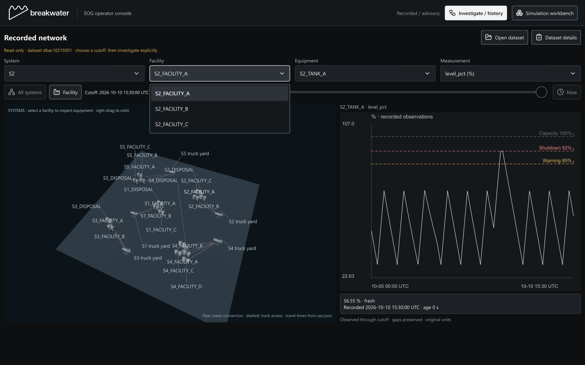
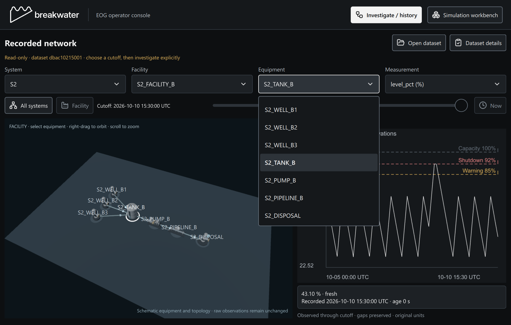

# EOG selector polish — November 8, 2026

Source: `4f8e9ce6f613a8abdc238af801a16024cb7e209d`. The source change is confined to `desktop/qml/EogDatasetPanel.qml`: one shared 40-pixel ComboBox presentation for System, Facility, Equipment and Measurement. Existing controller models, current-value bindings and activation callbacks remain intact. Menus use the native ComboBox delegate model, readable rows and a bounded 280-pixel scrolling popup. No numerical, model, contract or control implementation changed.

## Actual verification

| Gate | Observed result |
| --- | --- |
| Normal CTest | 7/7, 13.97 seconds |
| AddressSanitizer CTest | 7/7, 72.51 seconds |
| Dataset Qt cases within each run | 24 passed, zero failed/skipped |
| Out-only native Qt interaction probe | 10/10 normal and 10/10 compact; exit 0, empty stderr |
| Installed workbench UI gates | 9/9 normal and 9/9 compact; exit 0, empty stderr |
| Installed modules observed | 25 per size, all app/Qt modules from installed bin; hashes retained |

Both build configurations used MSVC 14.44.35219.0, existing pinned Qt 6.12.0 and one compile worker each. Scoped CTests were `desktop.eog_dataset` plus EOG analysis, overview and facility rendering in normal/compact sizes. This was not a repeat of the entire scientific suite.

The out-only probe linked the actual fresh application Main/QML/controller objects, replacing only the verification helper. It loaded the official three-file mock dataset through the real controller, clicked each of the four selectors, opened its popup, sent actual native Qt arrow/Return keys, and verified the changed selection matched the corresponding backend property. Dataset identity and workbench controls remained unchanged. Normal was 1440×900, compact 1100×700; actual DPR was 1.75. Menus measured 198/122/280/122 pixels high for the observed 5/3/8/3 choices. These are native Qt events, not global OS input or a manual accessibility audit. The helper is not the installed executable.

The representative untouched screenshots below show the normal Facility menu and compact Equipment menu. Source/result/provenance and all captured stdout/stderr are in [the evidence folder](evidence/eog-selector-polish/manifest.json); copied artifacts are byte-identical to the local originals. Earlier probe attempt 1 remains local; attempt 2 also changes the last-index Measurement selection using Up rather than accepting a no-op.

## Local qualified package

Package: `C:\Users\lucas\Documents\Codex\2026-11-07\for-x20\work\Breakwater-eog-validation-review\out\Breakwater-Demo-Selectors`.

- Application SHA256: `02dc65934cc505a2923490ed316d44240205958f7dc07e7834807256e5f19c3e`.
- Unchanged live-check SHA256: `5ff3da50d7af81ea75ba8f64267a015294c536630c1e261c9eaa4edf8ae136d4`.
- Reviewed local GUI launcher: `Launch-Breakwater.exe`, SHA256 `87101f384ae13005ac07a5acac0580d03f07a96dec411aaf18f8bdddcf7bd2ba`; adjacent configured `Start-EOG.cmd` / `Start-Sandbox.cmd` and `bin/qt.conf` were copied unchanged from the reviewed package.

The GUI launcher supplies process-only pinned Python, evaluator ABI 1.1 and D3D11/WARP; its default opens the official dataset with a separate `out/demo-operator-history.sqlite`. It does not change user environment/registry or NVIDIA credentials. No hosted request was made during this qualification. Earlier genuine hosted search evidence retains its original runtime identity; this QML-only increment does not create a new hosted qualification or mathematical accuracy claim. Existing user application windows were not closed or controlled.
