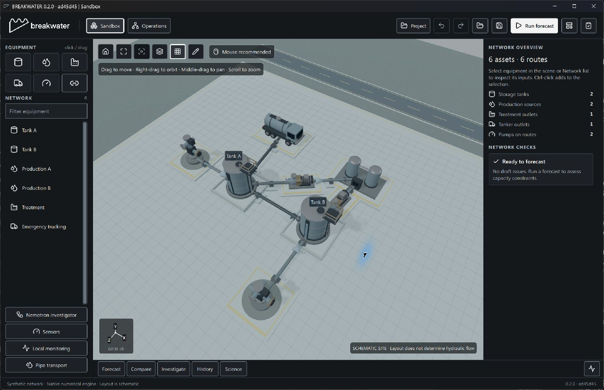
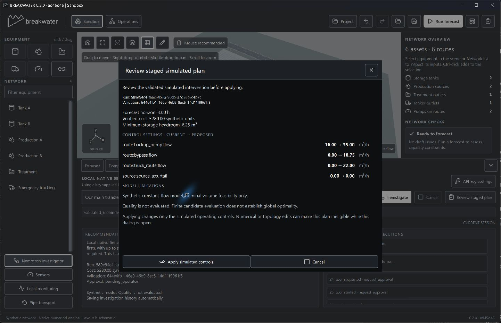
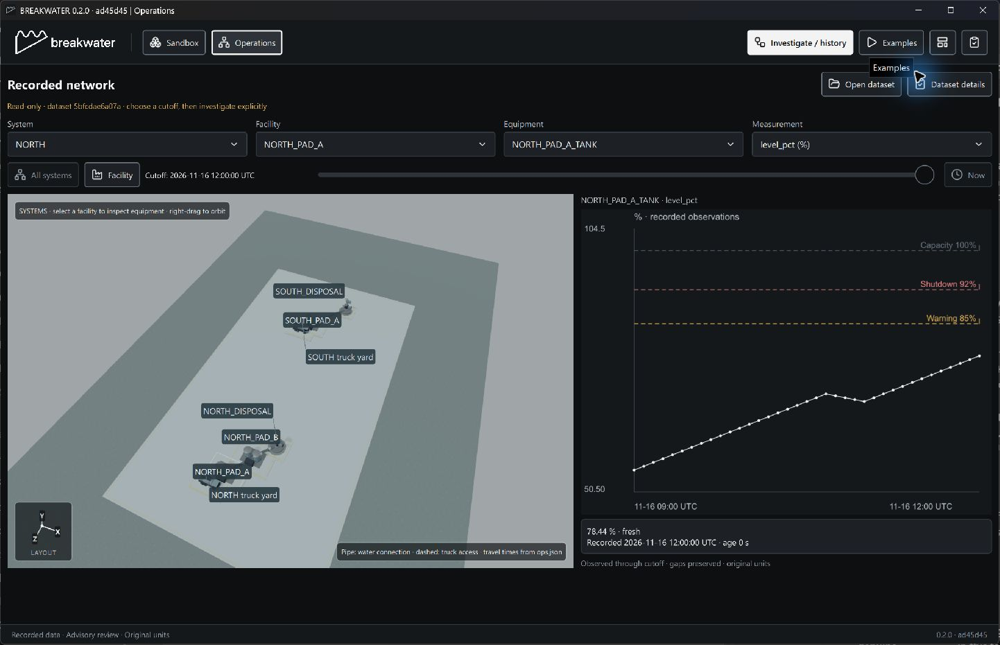
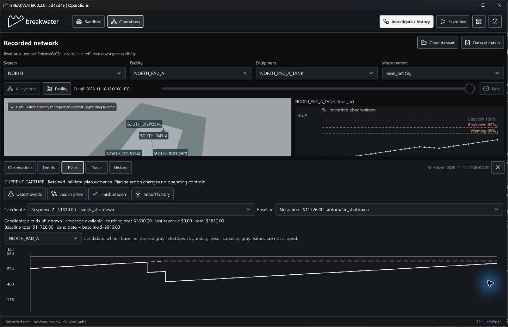
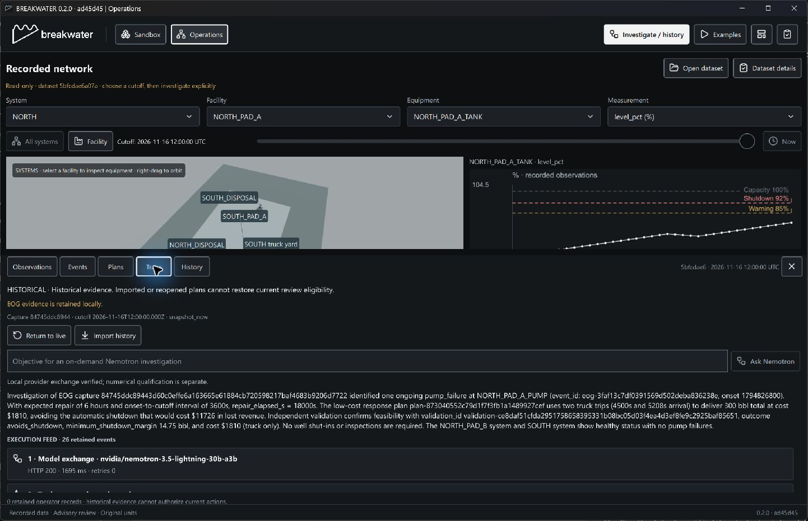

# Actual candidate screenshots

## Current framing UI: cd4dc5f

Three unaltered Windows Computer Use captures of the running, verified
application source `cd4dc5f60b7554c6bb93460ba2741b940865b76c`, captured on
November 20, 2026. Only selection, camera and temporary panel state changed.
No forecast, new model request or operating-control application was performed
for these captures. The saved user project remains private. Exact image and
executable hashes are in the [capture record](../../evidence/candidate-readiness/gallery-cd4dc5f.json).

| Capture | Actual view |
| --- | --- |
| [Sandbox overview](framing-cd4dc5f/01-sandbox-overview.jpg) | Six-asset/six-route synthetic network, fitted perspective, industrial site, equipment navigator and overview inspector. |
| [Plan scene focus](framing-cd4dc5f/02-plan-scene-focus.jpg) | Actual Top network fit with Ctrl+Shift+F scene focus. Escape restored the panels. This is a schematic layout, not a hydraulic or geographic survey. |
| [Connections inspector](framing-cd4dc5f/03-connections-inspector.jpg) | Selected backup-pump route, exact Tank B → Treatment endpoints, 16 m³/h configured setting and separate available state. The route card explicitly distinguishes direction/settings from measured delivery. |

These supplement the older seven views below. The planned eight-view gallery
for the final combined candidate is still pending; older analysis screenshots
are not relabeled as current-candidate results.

## Earlier candidate: ad45d45

Seven unaltered native JPEG captures from the relocated Windows candidate,
source `ad45d4538bc30fd9839fc79171ae1ae8dc71d399`, on November 18, 2026 local time.
Each is 1442×931 pixels. No generated mockups, credentials or official challenge
datasets are shown. See the [capture hashes and facts](../../evidence/portfolio/release-readiness/gallery-ad45d45.json)
and [source-qualified results](../../evidence/portfolio/release-readiness/README.md).

| Capture | What actually ran |
|---|---|
| [Sandbox overview](01-sandbox-overview-ad45d45.jpg) | Healthy synthetic six-asset/six-route network, industrial site and navigator. No forecast or control application. |
| [Equipment close-up](02-equipment-closeup-ad45d45.jpg) | Tank A selected with Focus; tank access hardware, pipe joints, pumps and tanker detail. View selection changes no controls. |
| [Native comparison](03-sandbox-comparison-ad45d45.jpg) | Actual failed-pump forecast, local finite-grid search and independent validation. Baseline headroom −116 m³; candidate headroom 6.25 m³ over three hours. The overflowing baseline is not clipped. Candidate cost 5,280 synthetic modeled units, not a claimed saving against the infeasible zero-control-cost baseline. |
| [Exact-plan review](04-exact-plan-review-ad45d45.jpg) | Run and independent-validation IDs, current/proposed controls, m³/h units and headroom. Captured before application. A later explicit simulated apply and reset were checked separately. |
| [Operations observations](05-operations-observations-ad45d45.jpg) | Self-authored NORTH/SOUTH dataset at 2026-11-16 12:00 UTC. Original-unit recorded measurements and a schematic 3D layout. Import starts no analysis. |
| [Operations plans](06-operations-plans-ad45d45.jpg) | Fresh packaged local search and separate exact-plan validation. Modeled baseline $11,726, selected response $1,810, shutdown margin 14.75 bbl. These numbers belong only to this synthetic capture. No operating controls applied. |
| [Hosted history trace](07-hosted-history-trace-ad45d45.jpg) | Genuine final-candidate hosted run 2, reopened as historical evidence: 9 model requests, 8 executed tools and 26 retained events. HTTP metadata/model identity are visible; imported history cannot restore review. Opening the archive makes no new model request. |

## Earlier captures, retained with their original scope

Captured from running portable candidates on November 18, 2026. The original
gallery uses clean commit `97be3c1c607a33d30441a346b3307dad7c84079e`; the repaired
recording capture explicitly uses `6cb258756bd0feb0cc7d6c37283ce9f0b7d6f24e`. These are
unaltered application captures, not mockups. The native window capture supplies
JPEG images; no credentials or private datasets are shown. The laptop's display
scaling affects apparent text size. The results dock was expanded using its
draggable top edge.

| Capture | What actually ran |
|---|---|
| [Sandbox comparison](sandbox-comparison.jpg) | Failed-pump forecast plus actual local finite-grid search and independent candidate validation. The no-action baseline overflows; the selected candidate remains below capacity. |
| [Local investigation](sandbox-local-investigation.jpg) | Native tool executions, retained run/validation identities and a labeled finite-grid recommendation. No hosted model request. |
| [Plan review](sandbox-plan-review.jpg) | Exact run, validation, controls, units and headroom before explicit simulated application. Captured with controls left unapplied. |
| [Operations overview](operations-overview.jpg) | Self-authored two-system dataset, original-unit measurements and schematic 3D layout. |
| [Operations plans](operations-plans.jpg) | Real packaged provider search; $11,726 modeled no-action baseline and $1,810 selected response for this specific synthetic capture. Search alone is not advisory approval. |
| [Recorded Nemotron investigation](operations-recorded-nemotron-6cb2587.jpg) | Final package `6cb2587`, 28 real retained model/tool events, HTTP metadata and grounded explanation. Historical evidence cannot authorize current actions; opening it makes no new hosted request. |

Local package and isolated-process verification metadata are retained under
`docs/evidence/portfolio`. The package is a verification candidate; public binary
release remains subject to owner review, licensing and clean Windows checks.
