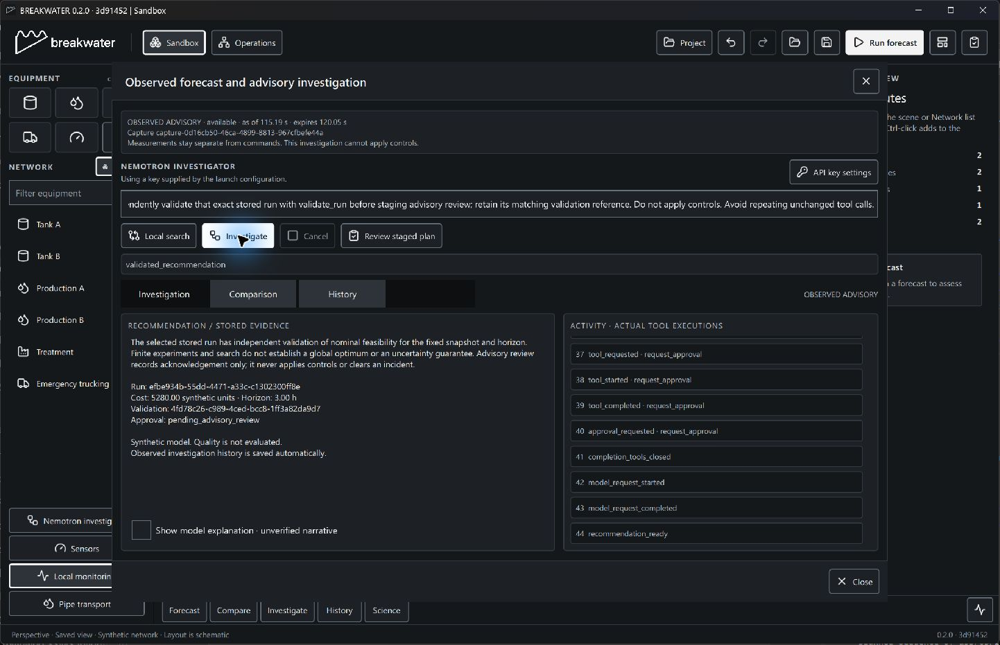

# Nemotron completion UI, engineering source 3d91452

These are original native screenshots of the actual source-qualified application, not a new portable release. [Results and limitations](../../../NEMOTRON_COMPLETION_RESULTS.md). [Image hashes](gallery.json).

- [Grounded observed recommendation](01-observed-grounded-recommendation.jpg): fixed snapshot, exact validation and advisory-only authority.
- [Operator review](02-observed-advisory-review.jpg): matching run/validation, current-to-proposed controls and acknowledgement-only wording. No action was taken.
- [Missing-coverage refusal](03-missing-coverage-explanation.jpg): native simulator support remains distinct from capture eligibility.
- [Reopened Operations history](04-operations-grounded-history.jpg): evidence-owned headline, bounded-search caveats and disabled historical review.

